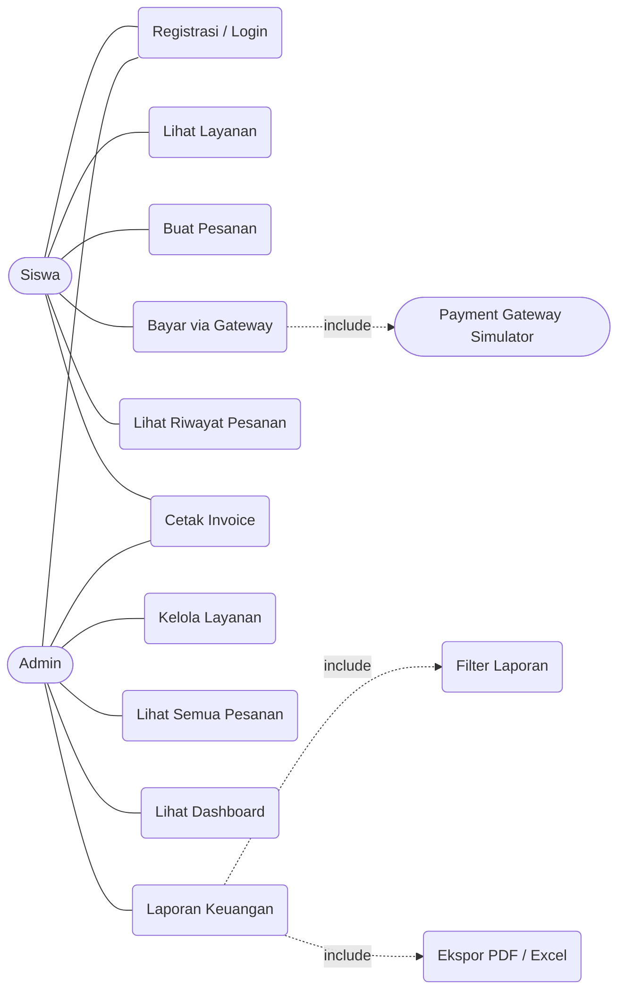
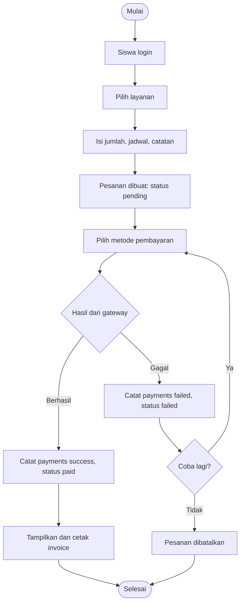
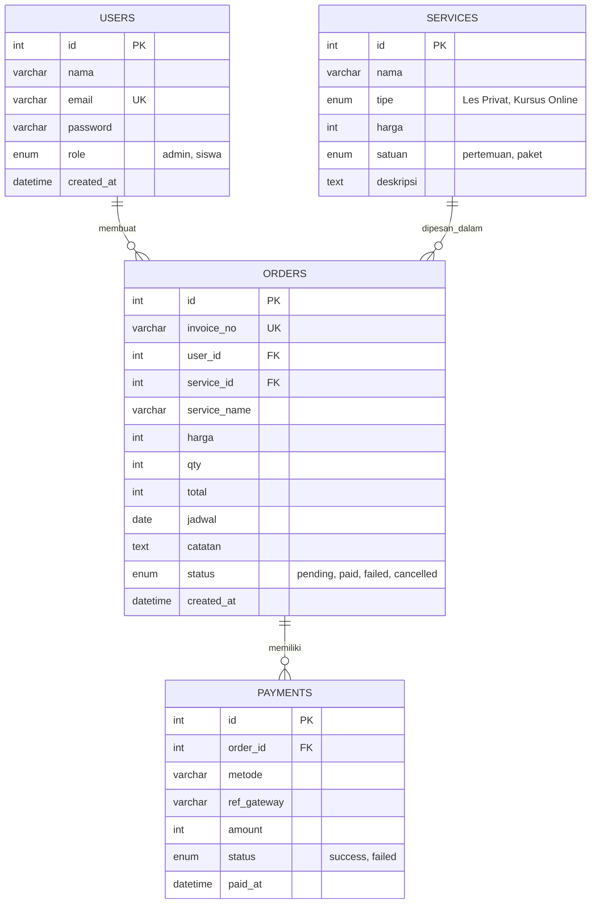

# Dokumentasi Perancangan: BelajarKu

Diagram memakai sintaks Mermaid (tampil di GitHub, VS Code dengan ekstensi Markdown Mermaid, atau https://mermaid.live untuk diekspor ke gambar).

## 1. Deskripsi Sistem

BelajarKu adalah website pemesanan jasa les privat dan kursus online (matematika, bahasa Inggris, pemrograman, desain, keterampilan digital). Siswa memilih layanan, memesan, membayar lewat payment gateway (simulator), dan mendapat invoice. Admin mengelola layanan dan memantau laporan keuangan.

## 2. Aktor

| Aktor | Hak akses |
|---|---|
| Admin | Kelola layanan, lihat semua pesanan, dashboard, laporan keuangan (filter, PDF, Excel, cetak), cetak invoice |
| Siswa | Registrasi/login, lihat layanan, buat pesanan, bayar, batalkan pesanan, lihat riwayat, cetak invoice |

## 3. Kebutuhan Fungsional

1. Registrasi dan login berbasis peran.
2. CRUD layanan oleh admin.
3. Pemesanan layanan (jumlah, jadwal, catatan) dengan total otomatis.
4. Pembayaran lewat payment gateway simulator (VA BCA, VA Mandiri, QRIS, GoPay).
5. Cetak invoice setelah pembayaran.
6. Laporan keuangan dengan filter dan ekspor PDF/Excel.
7. Dashboard ringkasan pendapatan.

## 4. Use Case Diagram

## 5. Flowchart Alur Pemesanan dan Pembayaran

## 6. ERD

Catatan desain: `orders` menyimpan salinan nama dan harga layanan saat pemesanan, sehingga invoice dan laporan lama tidak berubah bila layanan diedit atau dihapus.

## 7. Struktur Tabel

Lihat `database.sql` untuk DDL lengkap beserta data contoh.

## 8. Rancangan Halaman

| Halaman | Aktor | Fungsi |
|---|---|---|
| index.php | Publik | Daftar layanan |
| login.php / register.php | Publik | Autentikasi |
| pesan.php | Siswa | Form pemesanan |
| bayar.php | Siswa | Pembayaran (simulator gateway) |
| pesanan.php | Siswa | Riwayat dan pembatalan |
| invoice.php | Siswa, Admin | Invoice cetak |
| admin_dashboard.php | Admin | Statistik |
| admin_layanan.php | Admin | CRUD layanan |
| admin_pesanan.php | Admin | Semua pesanan |
| admin_laporan.php | Admin | Laporan keuangan |

## 9. Skenario Pengujian

| No | Skenario | Hasil yang diharapkan |
|---|---|---|
| 1 | Daftar akun siswa baru | Akun dibuat, otomatis login |
| 2 | Login dengan password salah | Pesan error |
| 3 | Siswa membuka halaman admin | Dialihkan ke beranda |
| 4 | Siswa memesan layanan | Pesanan pending, total = harga x jumlah |
| 5 | Bayar, pilih "Berhasil" | Status Lunas, invoice tampil |
| 6 | Bayar, pilih "Gagal" | Status Gagal, bisa dicoba lagi |
| 7 | Cetak invoice | Dialog print/PDF terbuka tanpa menu navigasi |
| 8 | Admin tambah/edit/hapus layanan | Daftar layanan berubah |
| 9 | Laporan: filter tanggal dan layanan | Tabel dan total sesuai filter |
| 10 | Laporan: ekspor PDF dan Excel | File terunduh dengan data terfilter |
